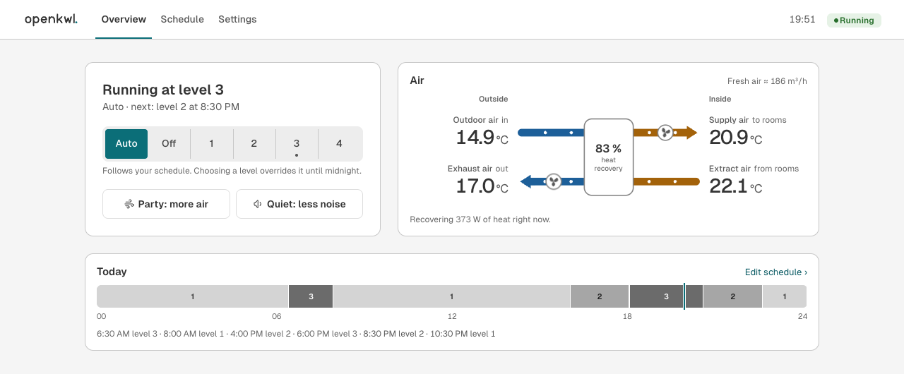
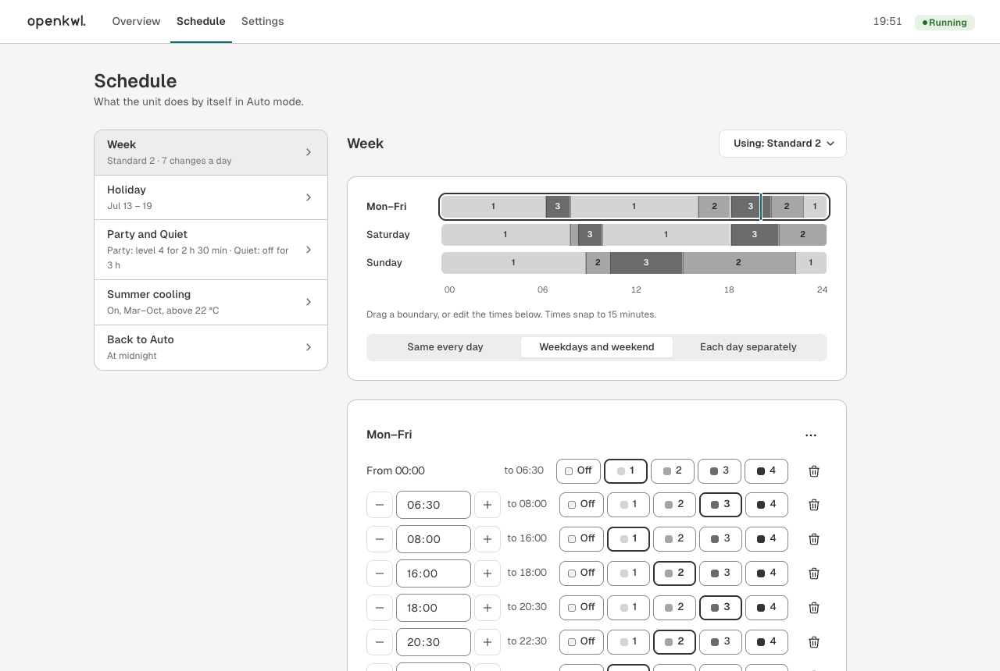
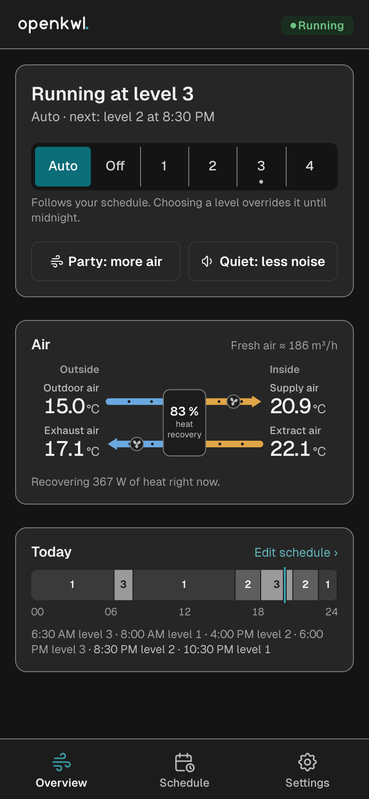

<div align="center">

# openKWL

**Open replacement firmware for Helios easyControls ventilation units**<br>
A web UI, a REST API and Home Assistant integration, on the controller you already have.


[Features](#features) ·
[Before you install](#before-you-install) ·
[Supported units](#supported-units) ·
[Status](#project-status) ·
[Try it](#try-it-in-two-minutes-no-hardware) ·
[Install](docs/INSTALL.md) ·
[Documentation](docs/README.md) ·
[Contributing](CONTRIBUTING.md)

<picture>
  <source media="(prefers-color-scheme: dark)" srcset="docs/images/overview-dark.png">
  
</picture>

</div>

openKWL replaces the main-controller firmware of Helios KWL EC ventilation units (first
easyControls generation, stock firmware 2.x). It is written in Rust. It keeps the **stock
bootloader** in flash untouched, so the original firmware can be installed again from the SD
card. For frost protection, bypass and fan control it **reimplements the stock firmware's
observed behaviour** (same thresholds and states) in new code. No Helios code or binaries are
included in this repository or in its releases.

> [!NOTE]
> **How it was made.** openKWL was written with substantial help from an AI coding assistant
> (Claude Code). I directed the work, reviewed the changes and test them on my unit. Reviews are
> especially welcome on the control logic (frost, bypass, fans) and the update path.

## Features

- **openKWL web UI** in English and German. Works on phones and desktops, in light and dark
  mode, served by the unit itself, with no cloud and no app.
- **Home Assistant over MQTT** with auto-discovery: a `fan` entity with levels and presets, the
  four temperatures, heat recovery, air flow, the filter reminder, bypass and faults
  ([details](docs/HOME_ASSISTANT.md)).
- **REST API** (`/api/v1`) with an [OpenAPI contract](api/openapi.yaml) and real
  authentication: salted PBKDF2 passwords, session tokens and a login throttle
  ([guide](docs/API.md)).
- **Weekly program** with 5 profiles, plus Holiday, Party, Quiet and "Back to Auto".
- **Heat-recovery figures:** efficiency, recovered power and energy, and an air-flow estimate
  from the fan speed ([how](docs/AIRFLOW.md)).
- **Updates from the browser.** One checked `.okwl` file holds the firmware and the web UI and
  is installed by the stock bootloader ([how it works](docs/UPDATING.md)).
- **Readable settings.** `CONFIG.INI` on the SD card, imported from the stock firmware with
  one command.
- NTP time with EU summer time, mDNS (`http://<name>.local/`), a filter reminder, bypass seasons,
  and the KWL-KNX extension module.

<table>
  <tr>
    <td width="68%"></td>
    <td width="32%"></td>
  </tr>
</table>

## Before you install

> [!WARNING]
> **openKWL is experimental.** It first booted on one unit (KWL EC 300 W R) on 2026-10-17 and
> has run there for a few days, with no frost season yet. Every other model is untested, and so
> are the KNX module and the firmware update from the web UI. See [Project status](#project-status).

- **No warranty.** openKWL is provided as is, without any warranty to the extent the law
  allows, and you install it at your own risk. It is an independent project, not affiliated
  with or endorsed by Helios Ventilatoren. "Helios" and "easyControls" are their trademarks,
  used here only to say which units this runs on.
- **Your manufacturer's warranty may end** when you replace the firmware. If the unit is still
  under warranty, ask Helios or your installer first.
- **It controls a ventilation unit.** Frost protection, bypass and fan monitoring follow the
  stock firmware's behaviour, but have run on one unit for a few days only. Watch the unit after
  installing. Don't rely on it where failed ventilation could harm people or the building, and
  don't leave it unattended in deep frost.
- **Not with a fireplace, stove or gas appliance that takes its air from the room.** openKWL is
  not covered by the unit's building approval (DIBt general technical approval, abZ). While it
  defrosts, the supply fan stops for up to several hours while the exhaust fan keeps running,
  which lowers the pressure in the home. Where a room-air-dependent combustion appliance shares
  the air with the ventilation, that can pull flue gas into the rooms: keep the original firmware.
- **Opening the unit means mains voltage.** Swapping the SD card needs the front cover open.
  That is work for a qualified electrician (Elektrofachkraft), or whoever local law allows to
  do it. Follow the unit's manual and the [safety notes](docs/INSTALL.md#safety).
- **Going back is designed to work in every state** of openKWL, because the stock bootloader is
  never touched and installs the original image from the SD card. Verified on one unit (a dry
  run with the original image); [how](docs/INSTALL.md#step-6-go-back-to-the-original-firmware).
- **Keep it on a trusted network.** The web UI uses plain HTTP; see [SECURITY.md](SECURITY.md).

## Supported units

The stock main-controller image is **one image for the whole first easyControls generation**
(74 article numbers). Parameter files on the SD card define the model.

| | Units |
|---|---|
| **Tested** | KWL EC 300 W R (articles 04232001–003, 04232050/51) |
| **Same platform, untested** | KWL EC 200/220/270/300/340/370/500 in their W, ET and D variants |
| **Not supported** | Pre- and post-heaters (EVH models, EH-Basis/ERW/SEWT/LEWT), the BEC/KWL-BE wall panels and sensor modules, easyControls 3.x, units still on firmware 1.x |
| **Extension module** | KWL-KNX: driven like the stock firmware (implemented, not yet tested on a unit) |

> [!IMPORTANT]
> **A KWL-BEC wall panel stops working** under openKWL: the panel is not driven, so it shows no
> current values and its keys do nothing. Use the web UI or Home Assistant instead. The panel
> works again with the original firmware. **Pre- and post-heaters are never switched on** by
> openKWL; a unit that relies on one for frost protection must stay on the original firmware.
> Support for either is not planned.

Your article number is on the sticker behind the front cover, or in the stock web UI under
*Technische Info* ("Ref. no."). Did you run it on another model?
[Report your unit](../../issues/new?template=unit_report.yml). Every report helps.

### Alternatives without new firmware

If you only want Home Assistant or scripts to talk to the unit, you may not need openKWL. The
stock firmware has a Modbus TCP server that existing projects use:

- [homeassistant-easycontrols](https://github.com/laszlojakab/homeassistant-easycontrols), a
  Home Assistant integration (HACS);
- [eazyctrl](https://pypi.org/project/eazyctrl/), a Python library;
- the [openHAB Helios easyControls binding](https://www.openhab.org/addons/bindings/modbus.helioseasycontrols/).

## Try it in two minutes (no hardware)

All you need is [mise](https://mise.jdx.dev); it installs the pinned Rust, Node and pnpm.

```sh
git clone https://github.com/hholle/openkwl.git && cd openkwl
./dev.sh            # fetches and patches one crate on first run; simulator on :8080, web UI with hot reload on http://localhost:5173
```

The simulator (`tools/openkwl-sim`) runs **the same application code as the firmware**, against
a thermal model of the unit. Its "SD card" is the folder `sim-sd/`.

```sh
./dev.sh --setup                                   # start with the first-time setup wizard
./dev.sh --built                                   # production build, everything on :8080
./dev.sh -- --outdoor -8 --fixed-outdoor --icing --speed 60   # frost protection in fast motion
```

## Install on a unit

The [installation guide](docs/INSTALL.md) walks you through it with a second SD card, so your
original card stays untouched:

1. Back up the original card.
2. Dry run (recommended): install the *original* firmware from the second card, which proves
   the way back on your unit. It costs one more opening of the cover.
3. Build openKWL: `firmware/card.sh <settings.ini>`.
4. Install and test.

Once the normal build runs, later versions are designed to install from *Settings › Firmware
update*, without opening the unit ([details](docs/UPDATING.md)). That path is tested in the
simulator, not yet on a unit.

## Documentation

| | |
|---|---|
| **Using it** | [User guide](docs/USER_GUIDE.md) · [Home Assistant](docs/HOME_ASSISTANT.md) · [Updating](docs/UPDATING.md) · [FAQ and troubleshooting](docs/FAQ.md) |
| **Installing** | [Installation with a second SD card](docs/INSTALL.md) · [Security model](SECURITY.md) |
| **Integrating** | [REST API guide](docs/API.md) · [OpenAPI contract](api/openapi.yaml) · [MQTT topics](docs/HOME_ASSISTANT.md#mqtt-topics) |
| **Developing** | [Contributing](CONTRIBUTING.md) · [Development guide](docs/DEVELOPMENT.md) · [Architecture](docs/ARCHITECTURE.md) · [Firmware internals](firmware/README.md) · [Roadmap and open work](docs/PLAN.md) |

All documents are listed in [docs/README.md](docs/README.md).

## How it is built

```
            openKWL web UI                    Home Assistant
                    │ HTTP /api/v1                  │ MQTT
┌───────────────────┼───────────────────────────────┼─────────────────┐
│ openkwl-app  (no_std)   REST handlers · control loop · persistence   │
│   openkwl-core · openkwl-api · openkwl-auth · openkwl-config ·          │
│   openkwl-ha · openkwl-bus · openkwl-update                            │
└───────────────────┬───────────────────────────────┬─────────────────┘
       firmware/ (Embassy, STM32F207)          tools/openkwl-sim (host)
       drivers, SD card, network               thermal model, files, HTTP
```

All behaviour lives in `no_std`, allocation-free crates that are tested on the host. The
firmware is only a thin hardware layer, and the simulator is a second, equally thin platform for
the same code. That keeps the firmware small: it has to fit the stock slot of 223.5 KB. See
[ARCHITECTURE.md](docs/ARCHITECTURE.md) for the crates, the runtime and the design decisions.

**Tech stack:** Rust (Embassy, smoltcp, embedded-sdmmc, heapless, serde-json-core) ·
TypeScript (React 19, Mantine 9, Vite) · host tests for every crate and for the web UI
([how to run them](docs/DEVELOPMENT.md#tests-and-checks)).

## Project status

openKWL first booted on one KWL EC 300 W R on 2026-10-17 and has run there for a few days.
It has not been through a frost season yet.

| Area | State |
|---|---|
| Control logic (frost, bypass, fans, NTC, efficiency) | Reimplements the behaviour observed in the stock 2.24 firmware; tested on the host and in the simulator; running on one unit for a few days; defrosting not yet seen on the unit |
| Web UI, REST API, Home Assistant | Implemented; tested on the host and in the simulator |
| Firmware update from the web UI | Tested in the simulator; not yet run on a unit |
| KNX module | Implemented from the stock firmware's observed behaviour; not yet tested on a unit |
| Other models, BEC panel, heaters | Untested / not supported |

Still to confirm on the unit ([details](docs/PLAN.md#2-to-confirm-on-the-unit-first-test)):
which fan output is supply and which exhaust, the bypass actuator and its direction, tacho
pulses per revolution, mains pulses per second, LED polarities and the SD card power polarity.
The behaviour was analysed in stock 2.24; the image you go back to is 2.27, whose control
functions appeared unchanged in that analysis.

The open work is in [docs/PLAN.md](docs/PLAN.md), and the changes per version in
[CHANGELOG.md](CHANGELOG.md).

## Contributing

Bug reports, reports from other unit models, and pull requests are all welcome. Please read
[CONTRIBUTING.md](CONTRIBUTING.md) first; the most useful contribution right now is a careful
[test report from your unit](../../issues/new?template=unit_report.yml). This project follows a
[Code of Conduct](CODE_OF_CONDUCT.md). Report security problems privately
([SECURITY.md](SECURITY.md)). For questions, see [SUPPORT.md](SUPPORT.md).

## License

openKWL is released under the [MIT License](LICENSE).

Third-party parts keep their own licences, all permissive: see [THIRD_PARTY.md](THIRD_PARTY.md);
every release carries their full texts. The patched `serde-json-core` keeps its MIT/Apache-2.0
licence ([vendor/README.md](vendor/README.md)), and the Geist fonts are under the SIL Open Font
License (`web/public/fonts/OFL.txt`).

## Acknowledgements

Built on [Embassy](https://embassy.dev), [smoltcp](https://github.com/smoltcp-rs/smoltcp),
[embedded-sdmmc](https://github.com/rust-embedded-community/embedded-sdmmc-rs),
[heapless](https://github.com/rust-embedded/heapless),
[serde-json-core](https://github.com/rust-embedded-community/serde-json-core),
[React](https://react.dev), [Mantine](https://mantine.dev),
[Tabler Icons](https://tabler.io/icons) and the [Geist](https://vercel.com/font) typeface.
The control logic reimplements the stock firmware's behaviour as observed for
interoperability; no Helios code is included.
