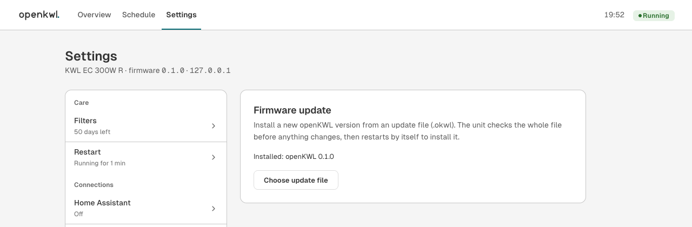

# Updating openKWL

Once openKWL runs on your unit, new versions install from the web UI: no card
swap and no opening the unit. The first installation always goes by SD card
([INSTALL.md](INSTALL.md)).

> [!WARNING]
> The update from the web UI has run on one unit (2026-10-24) and is tested in the simulator and
> in host tests. **Going back to the original firmware this way has not been tried yet**: keep
> the SD-card way back ready ([INSTALL.md, step 6](INSTALL.md#step-6-go-back-to-the-original-firmware)).

> [!NOTE]
> The firmware update is part of the **normal build** only. The `sd-log` and `rtt` debug builds
> don't have it (there is no room in flash). If your unit runs a debug build, install the normal
> build once by SD card ([INSTALL.md, step 5](INSTALL.md#step-5-install-and-test)).



## Install an update

1. **Get the update file** (`.okwl`), from a release or by building it yourself (below).
2. Open *Settings › Firmware update › Choose update file*, pick the file and confirm
   *Install update*. That's the only click; the rest runs by itself.
3. The unit stores and checks the whole file while it uploads, with a progress bar. Ventilation
   keeps running. A wrong or damaged file is refused with a message such as *"the update file
   is damaged (checksum)"*, and **nothing changes**.
4. If the file is fine, the unit restarts at once and the bootloader installs the new firmware.
   **The fans stop for about a minute; don't switch the unit off meanwhile.**
5. When the unit is back, the page reloads by itself with the new web UI, and you log in again.

If the automatic restart doesn't happen (for example, the connection drops right after the
upload), the section shows **Update ready** with *Install now*. A ready update also installs at
the next restart, whatever causes it.

## Build an update file

The card script builds it together with the files for an SD card:

```sh
firmware/card.sh <settings.ini from your card>     # → card/openkwl.okwl (and the card files)
```

Or by hand, from an image and a web UI folder:

```sh
(cd web && mise exec -- pnpm package:sd)                      # web UI → dist-sd/WWW
mise exec -- cargo run -p openkwl-pack -- \
    bundle card/BAS90001.bin dist-sd/WWW --out openkwl.okwl   # firmware + web UI

mise exec -- cargo run -p openkwl-pack -- \
    bundle card/BAS90001.bin --out firmware-only.okwl         # firmware only; the UI stays
```

`openkwl-pack bundle` checks the image first. Afterwards it reads the finished package back
with the same reader the unit uses. So a file that `openkwl-pack` writes is a file the unit
accepts.

## Going back

- **To an earlier openKWL:** install its `.okwl` file the same way.
- **To the stock firmware:** a package with only the original image switches back the same way,
  and the unit keeps the original's settings. Get the image from Helios' firmware download or
  your card's `basback.bin`, and check its MD5 (`5dbf83d504f07f923a3c5e5d3202c927` for 2.27)
  and `openkwl-pack verify` first, as in [INSTALL.md, What you need](INSTALL.md#what-you-need).
  `bundle` checks the image again:

  ```sh
  mise exec -- cargo run -p openkwl-pack -- bundle backup/BAS00227.bin --out stock-2.27.okwl
  ```
- **Without the web UI** (for example, openKWL doesn't start): the SD card procedure in
  [INSTALL.md, step 6](INSTALL.md#step-6-go-back-to-the-original-firmware). It needs the cover
  open. It is designed to work whatever happened before, because the bootloader runs before any
  firmware; verified on one unit (a dry run with the original image).

## What can go wrong, and what happens then

| Situation | Result |
|---|---|
| Wrong file, damaged download, upload cut off | Refused; nothing is armed, and the unit keeps running unchanged |
| A second upload while an earlier one is ready | Refused (409): restart first to install the waiting one; it stays intact |
| The SD card is full or fails while writing | Refused with *"the SD card could not store the update"* |
| Power cut while the bootloader flashes | The image still has its name, so the next power-on should flash again (from the bootloader's code; not tried) |
| The new firmware doesn't start | Go back by SD card ([INSTALL.md, step 6](INSTALL.md#step-6-go-back-to-the-original-firmware)) |
| Two browsers upload at once | The second gets *"another update is being uploaded"* (409) |

## How it works

### The `.okwl` package format

One file holds the firmware and the web UI, so the two always change together. It is a simple,
uncompressed archive that the unit can check piece by piece, without holding it in its 128 KB
of RAM.

```
offset  size  field
0       8     magic "OKWLPKG1"
              entries, one after the other:
        12      name: 8.3, upper case, NUL-padded ("FIRMWARE.BIN", "INDEX.HTM", …)
        4       length: u32, little-endian
        n       data
              terminator:
        12      zero bytes
        4       CRC-16/XMODEM of everything before this field, as u32, little-endian
```

- **The first entry is always `FIRMWARE.BIN`**, exactly 0x37E04 bytes: the image as the stock
  bootloader expects it (0x37E00 bytes for flash 0x08008000–0x0803FDFF, then its CRC-16 and two
  zero bytes).
- **All other entries are web UI files.** They are written as they are; they're gzipped
  already.
- A package with only `FIRMWARE.BIN` updates the firmware and leaves the web UI alone.
- The reference implementation is [`crates/openkwl-update`](../crates/openkwl-update/src/lib.rs),
  which the firmware, the simulator and `openkwl-pack` all use.

### Checks

Everything is checked while the file arrives; nothing is switched before the last byte has
passed.

| Check | Catches | Message |
|---|---|---|
| Magic `OKWLPKG1` | Not an update file | *not an openKWL update file* |
| First entry is a complete `FIRMWARE.BIN` | Wrong or truncated package | *the update file has no firmware image* |
| Entry names are plain 8.3 names | Paths, odd characters | *the update file has an invalid file name* |
| Initial stack pointer in 0x20010000–0x2001FFEF, 4-aligned | Not firmware for this unit; an image the bootloader's jump would crash | *the firmware image would not start on this unit* |
| Reset and exception vectors: Thumb addresses inside the slot | Same | same |
| Image CRC-16 trailer matches | Damaged image | *the firmware image is damaged (checksum)* |
| Package CRC-16 matches | Damaged or cut-off upload | *the update file is damaged (checksum)* |
| Nothing after the terminator | Wrong file | *the update file has extra data at the end* |

> [!IMPORTANT]
> These checks catch **accidents**, not **attacks**. A CRC is not a signature: anyone who can
> log in to the web UI can install firmware they built themselves, just as anyone with the SD
> card can. The login is the protection, as on the stock unit. See [SECURITY.md](../SECURITY.md).

### On the SD card

1. **The image** goes to the card root as `BAS90001.BIN` or `BAS90002.BIN`, whichever
   `settings.ini` doesn't name right now. A later upload that fails halfway never damages an
   update that is ready but not yet installed.
2. **The web files** go to `WWW/` or `WWW2/`, whichever isn't being served. Then comes the
   marker `IMAGE.CRC`: the image's CRC, 2 bytes, little-endian.
3. **Arming**, only after every check has passed: `HELIOS/SETTINGS.BAK` gets a copy of
   `settings.ini` (once, the first time). Then the first line of `settings.ini` becomes
   `FwBasis=BAS9000n.bin`. Nothing else in `settings.ini` changes.
4. **At the next start**, the stock bootloader sees `FwBasis=`, programs the image and renames
   the file to `basback.bin`.
5. **At boot**, openKWL reads its own CRC from flash (0x0803FE00). It serves `WWW2/` only if
   that folder's marker matches the CRC; otherwise it serves `WWW/`. So the web UI always
   matches the running firmware, and a failed install keeps the old pair.

### The API

`PUT /api/v1/system/update` with the package as `application/octet-stream` (up to 2 MB) and a
session token:

| Status | Meaning |
|---|---|
| 204 | Checked, stored and armed; installs at the next restart (`POST /api/v1/system/reboot`) |
| 400 | The package failed a check; `message` says which |
| 401 | Not logged in |
| 409 | Another upload is running, or an earlier update waits for its restart |
| 413 | Larger than 2 MB |
| 503 | The SD card is missing or could not store the update; also the answer of builds without the update feature |

```sh
curl -X PUT http://<unit>/api/v1/system/update \
  -H "Authorization: Bearer $TOKEN" -H 'Content-Type: application/octet-stream' \
  --data-binary @openkwl.okwl
```
